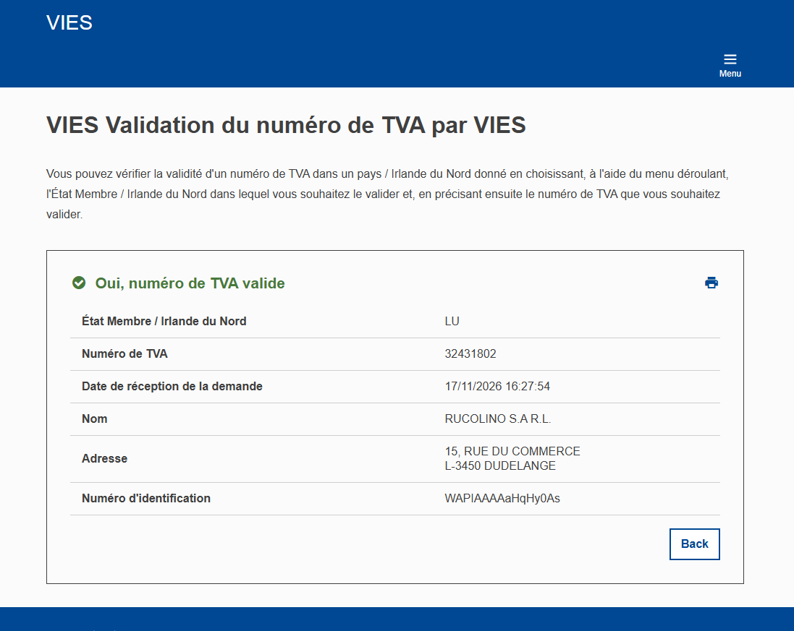

# Journal de Bord — Projet TVA API VIES
> Meridian Distribution | 16-17 novembre 2026

---

## 16/11/2026 — Phase 1 : Exploration (`exploration.ipynb`)

**Choix de la source (Q1)**
- Choix du CSV : plus léger, sans reformatage Excel

**Pays déclarés (Q2)**
- 15 valeurs distinctes dans `pays_declare`
  - 10 États membres UE : FR, DK, BE, LU, SE, PT, NL, IT, PL, FI
  - GB / UK (hors UE post-Brexit)
  - ZZ, QQ, XX (ne correspondent à aucun pays)
- Pour la France : 8 longueurs différentes, 44 préfixes distincts
  - Majuscule `FR`, minuscule `fr`, espaces, tirets, chiffres directs sans code pays

**Caractères parasites (Q3)**
- 18,13 % des lignes contiennent un caractère non alphanumérique
  - Espaces : 2 236 
  - Tirets : 471
  - Points : 404

**Valeurs vides (Q4)**
- `pandas` convertit `null` et `N/A` en `NaN` au chargement
  - `keep_default_na=False` permet de voir les valeurs brutes
- 261 valeurs vides sous 6 formes : `""`, `"   "`, `"-"`, `"N/A"`, `"null"`, `"NU.LL"`

**Incohérences pays / préfixe (Q5)**
- Sans `.strip().upper()` : 1 645 faux positifs
- 793 véritables incohérences

**Canaux de saisie et périmètre temporel (Q6)**
- Canaux de saisie homogènes (~2 000 lignes chacun, taux d'anomalies identiques)
- 21 mois : 01/01/2024 → 01/10/2025, ~475 saisies/mois

---

## 17/11/2026 — Phase 2 : Nettoyage (`nettoyage.ipynb`)

**Restructuration**
- Les notebooks ajoutent le dossier `api` au chemin d'import avec `sys.path.append(str(Path("../api").resolve()))`

**Blocage résolu — `normaliser()` plante sur les `NaN`**
- `df["numero_tva"].apply(normaliser)` → `AttributeError: 'float' object has no attribute 'upper'`
- Cause : pandas stocke les vides en `NaN` (float), pas en `None`
  - `(None or "")` → `""` ✅ — `(float("nan") or "")` → `NaN` ❌
- Première solution : `df["numero_tva"].fillna("").apply(normaliser)`

**Consigne du formateur — chargement et normalisation**
- Le CSV est chargé avec `pd.read_csv(data_dir / "numeros_tva.csv", dtype=str, keep_default_na=False)`.
- `dtype=str` conserve les colonnes comme du texte et `keep_default_na=False` empêche pandas de convertir les valeurs vides ou les textes comme `N/A` et `null` en `NaN`.
- Avec ce chargement, `df["numero_tva"].apply(normaliser)` suffit ; `.fillna("")` n'est plus utilisé.

**Normalisation et doublons**
- `normaliser()` met les numéros en majuscules et retire les caractères non alphanumériques.
- Le comptage des numéros normalisés exclut les marqueurs vides `""`, `NA` et `NULL`.
- 396 numéros normalisés apparaissent plusieurs fois, soit 438 occurrences supplémentaires.
- Après avoir gardé une seule ligne par numéro normalisé renseigné, le tableau contient 9 562 lignes. Les lignes avec un marqueur vide sont conservées.

**Validation structurelle**
- Les motifs renvoyés par `valider()` et leur traitement sont documentés dans le notebook.
- Après normalisation, `N/A` devient `NA`, et `null` ou `NU.LL` deviennent `NULL`. Transmis directement à `valider()`, ces marqueurs seraient classés `pays_non_couvert` plutôt que `vide`. Ils sont donc remplacés temporairement par une chaîne vide avant la validation, sans modifier la colonne normalisée.
- Sur les 9 562 lignes, 5 802 ont le motif `ok`, 2 499 `cle_invalide`, 1 000 `pays_non_couvert` et 261 `vide`.
- Le motif `ok` indique que le numéro passe le contrôle structurel ; il reste à vérifier dans VIES.

**Entonnoir chiffré**
- Le fichier contient 10 000 lignes au départ.
- Après avoir gardé une seule ligne par numéro normalisé renseigné, il en reste 9 562.
- 5 802 lignes sont candidates à une vérification par VIES.
- Le nettoyage évite 4 198 appels par rapport à un appel par ligne du fichier de départ.

**Échantillon de test VIES**
- Choix de 20 numéros portant le motif `ok`, à raison de deux par pays, déterminé par le préfixe de `tva_normalisee` plutôt que `pays_declare`.
- Le code Python de test VIES a été préparé avec l'aide de l'IA, sous mes directives, pour construire automatiquement les URL et chronométrer les appels, plutôt que de saisir chaque URL à la main.
- Le premier test manuel sur `BE0903436719` a renvoyé `isValid: false` et `userError: INVALID`. Un numéro conforme au contrôle structurel n'est donc pas nécessairement confirmé par VIES.
- Deux numéros ont renvoyé `VALID` dans les tests : `LU32431802` et `FI32156376`.
- Pour la vérification manuelle sur le site VIES, `LU32431802` a été choisi parmi les numéros ayant reçu `VALID`. Le pays `LU` et le numéro `32431802` ont été saisis dans les champs du numéro à vérifier ; le site a confirmé sa validité et affiché les informations associées. La capture d'écran du résultat est jointe ci-dessous.
- Un second échantillon de 20 numéros différents a été tiré au hasard, toujours à raison de deux par pays. Les appels ont été espacés de trois secondes.
- Sur les 40 appels, 25 ont renvoyé `INVALID`, deux `VALID`, 11 `MS_MAX_CONCURRENT_REQ` et deux `MS_UNAVAILABLE`. Les 13 dernières réponses signalent une limite ou une indisponibilité du service ; elles ne permettent pas de conclure sur la validité des numéros.
- Parmi les 27 réponses `VALID` ou `INVALID`, le temps moyen est de 1,728 seconde, la médiane de 0,406 seconde et l'écart-type de 2,350 secondes. Les temps vont de 0,093 à 7,830 secondes ; les réponses lentes tirent la moyenne vers le haut.
- Le même second échantillon a été testé une nouvelle fois avec une pause de 30 secondes. Cette fois, 15 appels ont renvoyé `INVALID`, un `VALID` et quatre `MS_MAX_CONCURRENT_REQ` ; aucun `MS_UNAVAILABLE`. Avec la pause de trois secondes, ce même échantillon avait donné 12 `INVALID`, un `VALID`, cinq `MS_MAX_CONCURRENT_REQ` et deux `MS_UNAVAILABLE`.
- Le délai plus long a donc coïncidé avec 16 réponses `VALID` ou `INVALID` sur 20, contre 13 sur 20 auparavant, mais quatre appels restent limités. Parmi ces 16 réponses, le temps moyen est de 1,613 seconde, la médiane de 0,366 seconde et les temps vont de 0,105 à 6,051 secondes.
- À titre indicatif, en ajoutant une pause de 30 secondes à ce temps moyen et sans compter les reprises, l'estimation est d'environ 87 h 49 pour 10 000 appels et 50 h 57 pour les 5 802 candidats. La pause de 30 secondes n'élimine pas les limites du service ; ces estimations restent théoriques.

