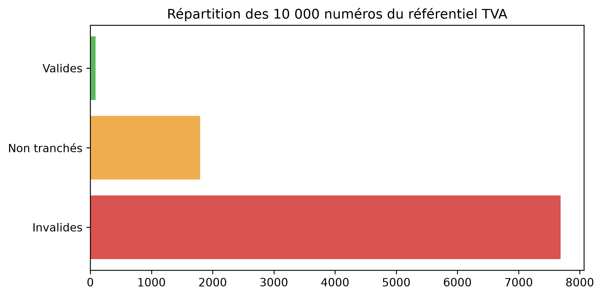
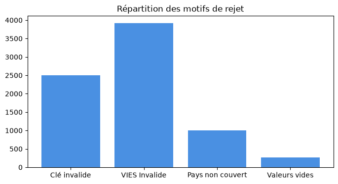
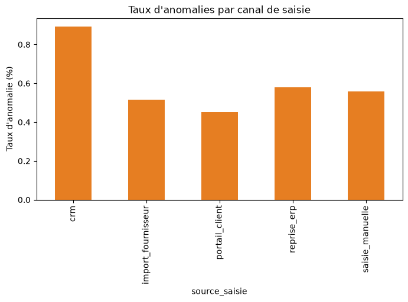

# Note à la Directrice Financière
**Objet :** Synthèse de l'audit du référentiel TVA (10 000 clients)

Madame la Directrice Financière,

Suite au contrôle fiscal, nous avons audité nos **10 000 numéros de TVA client** via un contrôle structurel et une campagne sur le registre officiel VIES.

### 1. État des lieux (Répartition finale)
* **Valides (~1% / ~87 clients) :** Structure et existence confirmées. Facturation hors taxe sécurisée.
* **Invalides (~65% / ~6 473 clients) :** Erreurs de structure, clés fausses ou rejetés par VIES. C'est la zone de risque critique à l'origine des rappels de TVA.
* **Non tranchés (~17% / ~1 741 clients) :** Numéros syntaxiquement corrects mais bloqués par les limites techniques de l'API VIES.

### 2. Origine des erreurs
Le taux d'échec global dépasse 70% sur tous nos canaux (CRM, imports). Aucune vérification n'était automatisée par le passé.

### 3. Recommandations opérationnelles
1. **Règle pour les non tranchés :** En cas d'échec de l'API, **facturer la TVA par défaut**. L'exonération hors taxe exige un statut `VALID` formel.
2. **Fréquence de contrôle :** Instaurer un recontrôle VIES **tous les 6 mois** pour tout client facturé hors taxe.
3. **Automatisation :** Bloquer la saisie de numéros invalides directement en amont dans l'ERP/CRM.

---
## Annexes : Visualisations des données
### Répartition finale des numéros

### Motifs de rejet

### Taux d'anomalies par canal

Cordialement,  
*L'équipe Data Analyse*
