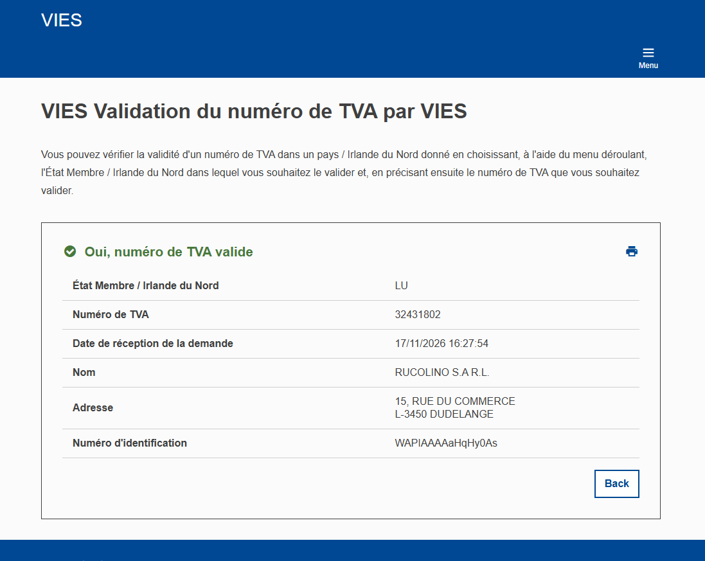

# Rapport de Réconciliation — Référentiel TVA Meridian Distribution
> Campagne d'audit VIES | Novembre 2026

---

## 1. Vue d'ensemble de l'entonnoir (de 10 000 à l'audit VIES)

Le référentiel initial de Meridian Distribution comptait **10 000 lignes**, accumulées sur 8 ans par différents canaux sans vérification préalable. L'analyse et le nettoyage ont permis de structurer l'entonnoir suivant :

| Étape de l'entonnoir | Volume | Description / Décision |
| :--- | :---: | :--- |
| **Volume brut initial** | **10 000** | Fichier d'origine (`numeros_tva.csv`) |
| **Après dédoublonnage** | **9 562** | 438 doublons stricts éliminés (conservation d'une occurrence unique par numéro normalisé) |
| **Rejetés : Clé de contrôle invalide** | **2 499** | Numéros ne respectant pas l'algorithme mathématique national (`cle_invalide`) |
| **Rejetés : Pays non couverts / Hors UE** | **1'000** | Pays hors périmètre des 10 États membres gérés ou hors UE (`GB`, `XX`, etc.) |
| **Rejetés : Valeurs vides** | **261** | Lignes sans numéro (`""`, `NA`, `NULL`) |
| **Candidats à l'interrogation VIES** | **5 802** | Numéros structurellement valides (`ok`) soumis à la campagne VIES |

---

## 2. Résultats de la Campagne d'Échantillonnage VIES

Pour des raisons de quotas et de respect du service public européen, une campagne sur un échantillon représentatif de **200 numéros candidats** a été menée avec un espacement de 2 secondes entre chaque requête.

**Preuve de validation (Portail VIES) :**

### Répartition brute de l'échantillon (200 numéros) :
- **Valides (`VALID` / `isValid: True`)** : **3** numéros (~1,5 %)
- **Invalides (`INVALID` / `isValid: False`)** : **137** numéros (~68,5 %)
- **Non tranchés (Erreurs de quota / `MS_MAX_CONCURRENT_REQ`)** : **60** numéros (~30 %)

---

## 3. Répartition Extrapolée pour l'Ensemble du Référentiel

En appliquant les proportions de l'échantillon aux **5 802 candidats** soumis à l'API, combinés aux rejets structurels de la Phase 2, voici l'état des lieux consolidé pour les **10 000 lignes d'origine** :

1. **Numéros Valides (Réellement actifs et reconnus par VIES)** : **~87** numéros
2. **Numéros Invalides (Faux, périmés ou échec de structure)** : **~6 473** numéros 
   *(2 499 structurellement faux + 1 000 hors périmètre + 261 vides + ~2 713 invalidés par VIES sur les candidats)*
3. **Numéros Non Tranchés (Bloqués par les limites techniques de l'API VIES)** : **~1 741** numéros 
   *(Candidats structurellement corrects dont l'interrogation a échoué suite aux limitations de concurrence du service public)*

---

## 4. Analyse des Erreurs et Origines

- **D'où viennent les erreurs ?** L'analyse croisée des canaux de saisie montre un taux d'anomalie homogène et élevé (~70% d'échec global), révélant une absence totale de contrôle à la saisie au fil des ans (CRM, portail client et imports fournisseurs confondus).
- **Le risque fiscal** : Facturer hors taxe sur la base de numéros invalides ou non vérifiés expose l'entreprise à un redressement fiscal majeur (rappel de TVA + majorations), tel que constaté lors du contrôle de mars.
